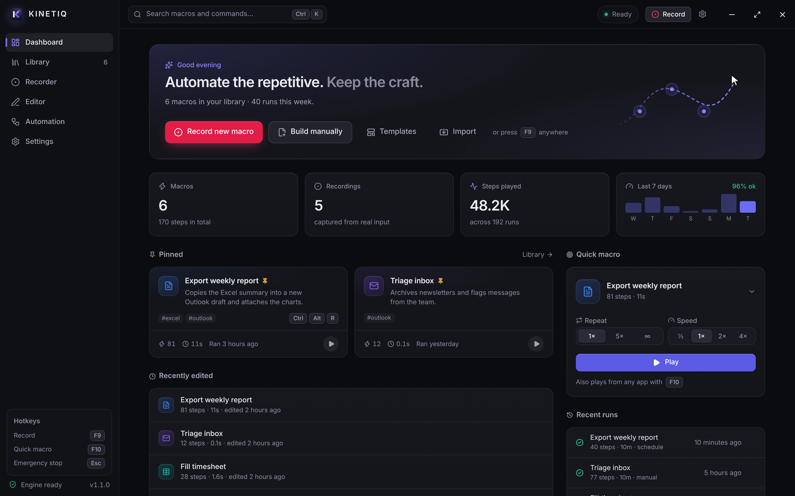
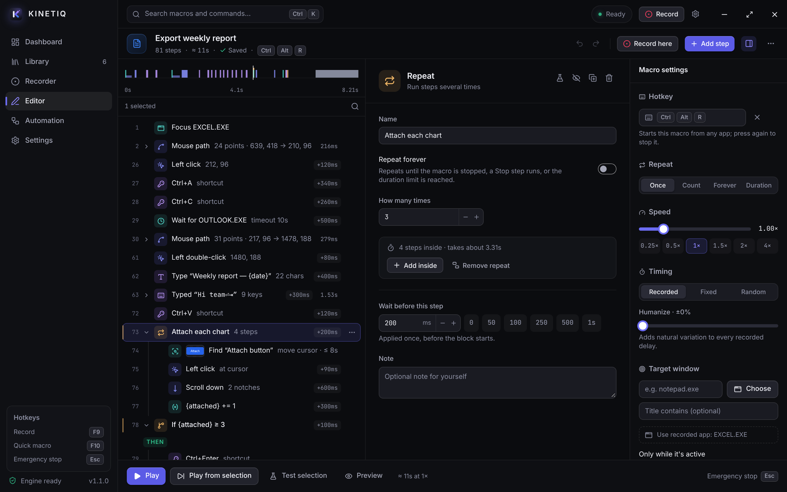
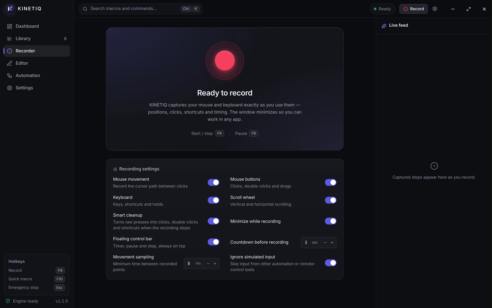
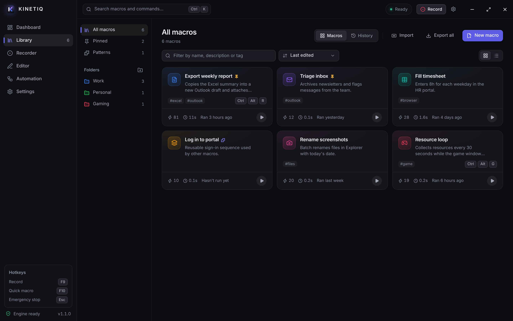
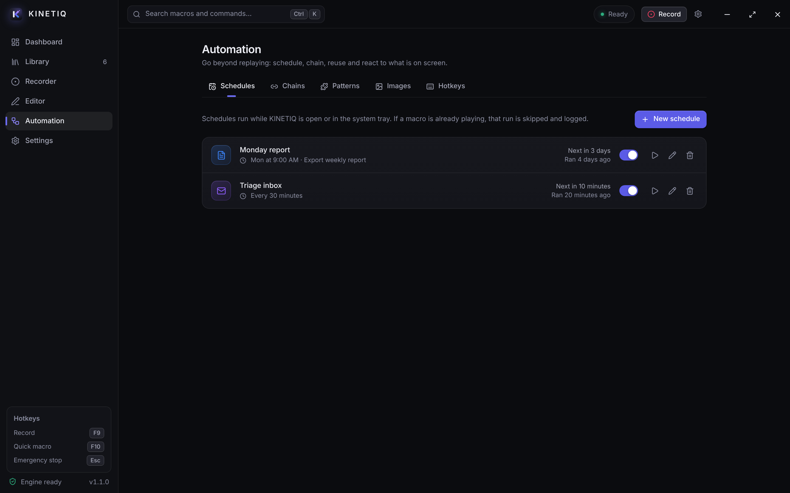

# KINETIQ

**A premium macro recorder for Windows 11. Free.**

Record what you do once — clicks, keystrokes, scrolling and timing — then refine it on a visual timeline and replay it from a button, a global hotkey, a chain or a schedule.

### [⬇ Download KINETIQ 1.1.0 for Windows](https://github.com/MrShark333/kinetiq-download/raw/main/KINETIQ_1.1.0_x64-setup.exe)

Windows 10 or 11, 64-bit · about 4 MB · no administrator rights needed · no account, no ads, no telemetry

---

## What it does

**Record anything you do**
- Mouse movement on every display, all five buttons, double-clicks, drags and scrolling, every key and shortcut, with the original rhythm.
- *Smart cleanup* turns raw presses into readable clicks, double-clicks and shortcuts without changing the timing.
- Apps you list (password managers by default) are never recorded, and a red indicator is always on screen while recording.

**Edit it visually**
- A timeline and a step list with drag-and-drop, undo, find, groups, repeats and conditions.
- Pick positions on screen, capture keys in your own keyboard layout, type text with `{variables}` such as `{date}`.
- Mouse paths and typed text collapse into one tidy row each, and huge recordings stay fast.

**Automate it**
- Play once, a number of times, forever or for a duration, at 0.25× to 4× speed, with optional human-like variation.
- Global hotkeys, an **emergency stop** that works from any app, schedules (once, every N minutes, chosen weekdays), and chains of macros.
- Wait for a window or an image on screen, then click it: image search finds buttons wherever they are.
- Window-aware macros: run only while an app is in front, bring it forward first, or follow it when it moves.

**Feels like Windows**
- Snap Layouts on the maximize button, the system menu on right-click or `Alt+Space`, rounded corners, `Shift+F10` context menus, a tray icon, taskbar progress and Windows notifications.
- Works snapped to half the screen, follows Windows Contrast themes and "reduce motion", and every control has a name for screen readers.

| Editor | Recorder |
| --- | --- |
|  |  |
| **Library** | **Automation** |
|  |  |

---

## Install

1. Download **[KINETIQ_1.1.0_x64-setup.exe](https://github.com/MrShark333/kinetiq-download/raw/main/KINETIQ_1.1.0_x64-setup.exe)** (or click it in the file list above, then **Download raw file**).
2. Double-click it. It installs for your user account only, so no administrator password is needed.
3. Windows may say *"Windows protected your PC"*, because KINETIQ is not code-signed. Click **More info**, then **Run anyway**.
4. KINETIQ opens when setup finishes, and is in the Start menu afterwards.

To update, run the newer installer: your macros and settings are kept. To remove KINETIQ, use **Settings → Apps** in Windows.

To check your download, compare `Get-FileHash KINETIQ_1.1.0_x64-setup.exe` in PowerShell with [SHA256.txt](SHA256.txt). What's new: [release notes](RELEASE_NOTES.md).

## Default hotkeys

| | |
| --- | --- |
| Start / stop recording | `F9` |
| Pause / resume | `F8` |
| Play / stop the quick macro | `F10` |
| **Emergency stop** (while a macro plays) | `Esc` |

All of them can be changed in **Settings → Hotkeys**.

## Privacy and safety

- Nothing is recorded or played unless you start it.
- Everything stays on your PC. KINETIQ has no account and sends nothing anywhere.
- Imported macros don't run from hotkeys or schedules until you have reviewed them.
- KINETIQ does not get around Windows security: the lock screen, UAC prompts and `Ctrl+Alt+Del` can't be recorded or automated.

## Good to know

- **Apps running as administrator** can only be recorded or automated when KINETIQ runs as administrator too (a Windows rule).
- **Games with anti-cheat** may ignore or flag simulated input. Use automation within each game's rules.
- **Positions depend on your setup:** recorded clicks assume the same displays and scaling. *Follow window* mode and image search handle windows and buttons that move.
- **Schedules** run while KINETIQ is open or in the tray.

## License

KINETIQ is free to download and use. It is not open source: see [LICENSE](LICENSE.txt).

Found a problem? [Open an issue](../../issues).
